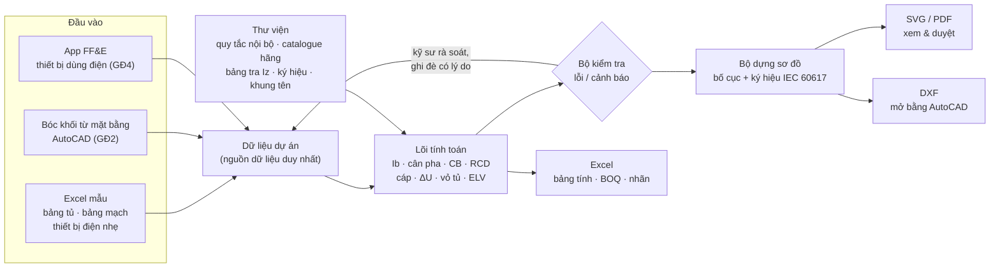

# Phương án tự động hóa thiết kế sơ đồ nguyên lý tủ điện & điện nhẹ

> **Phiên bản:** 0.3 · **Ngày:** 09/11/2026 · **Trạng thái:** đã chốt phạm vi và nền tảng ([mục 14](#14-các-quyết-định-đã-chốt)); đã có MVP GĐ1 (Excel → tự tính → cả bộ bản vẽ), bộ quy tắc chờ kỹ sư điện duyệt
>
> **Thay đổi so với 0.2:** đã làm lõi tính toán, Excel nhập liệu v2, lệnh tạo cả bộ bản vẽ và web app MVP (mục 11, 15). Bổ sung 3 quy tắc vào mục 6: phân bổ sụt áp tới thanh cái mỗi tủ (mặc định 2%), hệ số đồng thời giữa các tủ con, ống luồn tối thiểu Ø20 theo bản vẽ mẫu.
>
> **Thay đổi so với 0.1:** cập nhật theo 7 quyết định ngày 07/11/2026. Ưu tiên nhà ở/biệt thự và căn hộ; thiết bị Schneider, BOQ có đơn giá; **DWG là đầu ra bắt buộc** nên xuất DXF được đưa lên GĐ1; bóc khối từ AutoCAD đưa lên GĐ2; KNX nằm trong phạm vi điện nhẹ.

---

## 1. Tóm tắt

- **Ý tưởng cốt lõi:** không vẽ sơ đồ bằng tay nữa. Người thiết kế nhập **dữ liệu** (bảng tủ, bảng phụ tải, bảng thiết bị điện nhẹ theo phòng), công cụ tự **tính toán → chọn thiết bị → kiểm tra → vẽ sơ đồ → xuất bảng tính & BOQ**. Sửa một phụ tải thì bản vẽ, bảng tính và BOQ cùng cập nhật, không lệch nhau.
- **Công cụ (đã chốt):** web app chạy trên trình duyệt, cùng nền tảng với app FF&E đang dùng (file HTML, nhập/xuất Excel). Xuất **DXF theo khung tên và chuẩn layer của công ty**, mở trong AutoCAD rồi lưu thành **DWG chỉnh sửa được**. Ngoài ra xuất **PDF/SVG** để duyệt và **Excel** cho bảng tính, BOQ có đơn giá Schneider, nhãn.
- **Phạm vi (đã chốt):**
  1. Tủ điện hạ áp cho **nhà ở/biệt thự và căn hộ**: sơ đồ nguyên lý từng tủ và sơ đồ cấp điện tổng (cây tủ). Thiết bị **Schneider**.
  2. Điện nhẹ: LAN/Wi-Fi, CCTV, chuông cửa hình, kiểm soát ra vào, truyền hình, âm thanh, **nhà thông minh KNX**. Báo cháy chỉ thể hiện điểm giao tiếp. Đầu ra gồm sơ đồ nguyên lý dạng trục, sơ đồ tủ rack và bảng đấu nối.
- **Đầu vào:** nhập Excel thủ công (MVP), sau đó bóc khối từ bản vẽ mặt bằng AutoCAD.
- **Lộ trình:** 4 giai đoạn chính, khoảng 9–13 tuần. **Có MVP sau khoảng 4–6 tuần**: tự sinh sơ đồ nguyên lý 1 tủ điện từ file Excel, xuất DXF theo khung tên công ty.
- **Nguyên tắc an toàn:** công cụ là trợ lý tính toán. Kỹ sư điện nội bộ duyệt bộ quy tắc ở GĐ0, rà soát từng hồ sơ, có quyền ghi đè (phải ghi lý do) và chịu trách nhiệm ký.

---

## 2. Mục tiêu & phạm vi

### 2.1 Mục tiêu

| Mục tiêu | Chỉ số đo |
|---|---|
| Nhanh | Lập sơ đồ nguyên lý 1 tủ (≤ 24 mạch), kể cả rà soát: **≤ 30 phút** |
| Đúng | Không có lỗi số học. 100% mạch qua bộ kiểm tra (In, Iz, ΔU, RCD, Icu), hoặc có ghi chú ghi đè |
| Đồng bộ | Bản vẽ, bảng tính và BOQ sinh từ **cùng một bộ dữ liệu** |
| Thống nhất | Ký hiệu, layer, khung tên và mã bản vẽ theo một chuẩn công ty |
| Tái sử dụng | Bộ quy tắc và catalogue dùng chung cho mọi dự án. Dự án mới bắt đầu từ mẫu |

### 2.2 Phạm vi

| Trong phạm vi | Ngoài phạm vi giai đoạn đầu |
|---|---|
| Công trình **nhà ở/biệt thự** (thường 3 pha) và **căn hộ** (thường 1 pha, cấp từ tủ công tơ tầng) | Văn phòng, F&B–retail, khách sạn (bổ sung hồ sơ quy tắc sau) |
| Tủ tổng (MDB), tủ tầng/căn/khu (DB), tủ chức năng (điều hòa, bếp, bơm, chiếu sáng ngoài nhà) | Tủ trung thế, máy biến áp |
| Sơ đồ cấp điện tổng (cây tủ) | Vẽ mặt bằng đi dây tự động |
| Bảng tính phụ tải, chọn CB, cáp, RCD; cân pha; chọn vỏ tủ | Mạch điều khiển chi tiết (contactor/PLC), sơ đồ đấu dây hàng kẹp |
| Điện nhẹ: LAN/Wi-Fi, CCTV, ACS, chuông cửa hình, TV, âm thanh, nhà thông minh KNX | Báo cháy/chữa cháy: chỉ thể hiện điểm giao tiếp (liên động cắt điện, mở khóa cửa thoát nạn) |
| BOQ thiết bị tủ, cáp, thiết bị điện nhẹ **kèm đơn giá**; nhãn tủ, nhãn cáp | Tính ngắn mạch chi tiết và phối hợp chọn lọc theo bảng của Schneider (đưa vào GĐ4) |

---

## 3. Nguyên tắc thiết kế công cụ

1. **Dữ liệu là gốc, bản vẽ là đầu ra.** Mọi thay đổi đều sửa ở dữ liệu, sau đó xuất lại bản vẽ.
2. **Quy tắc minh bạch.** Mỗi giá trị do công cụ chọn đều kèm lý do (công thức, bảng tra, quy tắc nội bộ), bấm vào là xem được.
3. **Ghi đè có kiểm soát.** Kỹ sư được sửa bất kỳ lựa chọn nào. Công cụ vẫn kiểm tra lại và đánh dấu giá trị đã bị ghi đè.
4. **Chuẩn hóa trước, tự động sau.** Thống nhất quy tắc và ký hiệu nội bộ trước khi viết code. Tự động hóa một quy trình chưa thống nhất chỉ nhân bản cái sai nhanh hơn.
5. **Định dạng mở.** Dùng Excel, JSON, DXF, PDF; không khóa vào một phần mềm hay một hãng thiết bị.
6. **Con người chịu trách nhiệm.** Hồ sơ phát hành vẫn do kỹ sư có chứng chỉ hành nghề phù hợp kiểm tra và ký.

---

## 4. Kiến trúc tổng thể



| Khối | Vai trò |
|---|---|
| Dữ liệu dự án | Thông tin dự án, nguồn, cây tủ, mạch, thiết bị điện nhẹ, các giá trị ghi đè. Lưu thành file dự án (JSON/Excel) |
| Thư viện | Hồ sơ quy tắc theo loại công trình, catalogue thiết bị (mã, số cực, In, Icu, số module, giá), bảng tra dòng cho phép, ký hiệu, khung tên. Lưu dạng bảng để kỹ sư tự cập nhật mà không cần sửa code |
| Lõi tính toán | Các hàm thuần (không phụ thuộc giao diện) nên có thể kiểm thử tự động |
| Bộ kiểm tra | Phân loại kết quả thành 3 mức: lỗi (đỏ), cảnh báo (vàng), ghi chú (xanh). Xem [mục 6.8](#68-bộ-kiểm-tra-tự-động) |
| Bộ dựng sơ đồ | Đặt ký hiệu theo mẫu bố cục, tự ngắt trang, chèn khung tên |
| Bộ xuất | SVG/PDF, DXF, Excel |

### Quy trình người dùng

1. Tạo dự án từ mẫu và chọn hồ sơ quy tắc (giai đoạn đầu có 2 hồ sơ: nhà ở/biệt thự và căn hộ).
2. Nhập hoặc dán bảng tủ, bảng mạch (Excel mẫu), bảng thiết bị điện nhẹ theo phòng.
3. Bấm **Tính**. Công cụ chọn CB, RCD, cáp, cân pha, chọn vỏ tủ và hiện danh sách lỗi/cảnh báo.
4. Kỹ sư rà soát và ghi đè nếu cần, kèm lý do.
5. Xem trước sơ đồ, sau đó xuất PDF / DXF / Excel.
6. Lưu file dự án để sửa đổi và phát hành các lần revision sau.

---

## 5. Dữ liệu đầu vào

### 5.1 Thông tin dự án & nguồn

- Mã/tên dự án, địa chỉ, chủ trì, người kiểm tra, revision.
- Điện áp 220/380 V (có thể chọn 230/400 V), 50 Hz.
- Sơ đồ nối đất: TN-S / TN-C-S / TT.
- Dòng ngắn mạch dự kiến tại điểm đấu nối, Ik (kA). Lấy từ tòa nhà hoặc điện lực; nếu chưa có thì dùng giá trị mặc định có gắn cờ.
- Nhiệt độ môi trường thiết kế (mặc định 35 °C) và giới hạn sụt áp.
- Hồ sơ quy tắc theo loại công trình.

### 5.2 Bảng tủ

| Cột | Ví dụ | Ghi chú |
|---|---|---|
| Mã tủ | `DB-T1` | Duy nhất trong dự án |
| Tên / vị trí | Tủ điện tầng 1 – gầm cầu thang | |
| Cấp từ | `MDB` / mạch `F03` | Dùng để dựng cây tủ |
| Số pha | 3P+N+PE | Hoặc 1P+N+PE |
| Chiều dài cáp cấp (m) | 30 | Dùng tính sụt áp |
| Phương pháp lắp đặt | B1 – ống âm tường | Dùng tra Iz |
| Kiểu lắp / IP | Âm tường / IP40 | |
| Ks (tùy chọn) | 0,7 | Để trống thì lấy theo hồ sơ quy tắc |

### 5.3 Bảng mạch (đầu vào chính)

| Cột | Bắt buộc | Ví dụ |
|---|---|---|
| Mã tủ | ✔ | `DB-T1` |
| Mã mạch | Tự sinh nếu để trống | `C04` |
| Loại mạch | ✔ | Chiếu sáng / Ổ cắm / Khu ướt / Điều hòa / Bình nóng lạnh / Bếp / Động cơ / Cấp tủ con / Dự phòng |
| Mô tả phụ tải | ✔ | Ổ cắm P.khách, sảnh |
| Phòng / khu vực | Nên có | `P.khách`, `WC1`. Dùng để tự áp quy tắc khu ướt, ngoài nhà |
| Công suất | ✔ | `1800` W, hoặc `8 × 225` W |
| cosφ | — | Mặc định theo loại mạch |
| 1 pha / 3 pha | — | Mặc định 1 pha |
| Pha (L1/L2/L3) | — | Để trống thì công cụ tự cân pha |
| Chiều dài (m) | ✔ (hoặc mặc định có gắn cờ) | 25 |
| Ghi đè thiết bị / cáp | — | Ví dụ `RCBO 20A 30mA`, kèm lý do |

### 5.4 Điện nhẹ — bảng thiết bị theo phòng/tầng

| Tầng | Phòng | Ổ data | Ổ TV | AP Wi-Fi | Camera | Cửa kiểm soát | Màn hình chuông cửa | Loa (W) | Tủ rack phục vụ |
|---|---|---|---|---|---|---|---|---|---|
| T1 | P.khách | 2 | 1 | 1 | — | — | 1 | 2 × 6 | R1 |
| T1 | Sảnh | — | — | — | 2 | 1 | — | — | R1 |

### 5.5 Các nguồn nhập (mức tự động tăng dần)

1. **Excel mẫu (MVP):** dán từ bảng có sẵn, ít phụ thuộc nhất. File mẫu: `dien/mau/nhap-lieu-tu-dien.xlsx`.
2. **Bóc khối từ bản vẽ mặt bằng AutoCAD (GĐ2):** dùng lệnh `DATAEXTRACTION` để đếm block (đèn, ổ cắm, camera, AP…) theo phòng và xuất CSV để nhập vào công cụ. Muốn làm được, block mặt bằng cần có thuộc tính thống nhất (ví dụ `MA_MACH`, `CONG_SUAT`, `PHONG`). Ở GĐ0 sẽ chuẩn hóa thư viện block mặt bằng hiện có của công ty theo quy ước này.
3. **Liên kết app FF&E:** bổ sung các trường điện (điện áp, công suất, kiểu đấu nối ổ cắm/đấu cứng, có cần RCD) cho thiết bị như washlet, bình nóng lạnh, máy sấy khăn, gương sưởi, thiết bị bếp. Công cụ sẽ tự sinh dòng phụ tải tương ứng, tránh sót thiết bị cần cấp điện.

---

## 6. Bộ quy tắc tính toán — tủ điện

> Các giá trị dưới đây là **mặc định đề xuất**. Kỹ sư chủ trì sẽ chốt ở GĐ0 thành "Quy định thiết kế điện nội bộ v1", và đều chỉnh được trong thư viện quy tắc.

### 6.1 Chuỗi xử lý

1. Tính dòng làm việc **Ib** của từng mạch.
2. **Cân pha** tự động cho các mạch 1 pha.
3. Chọn **thiết bị bảo vệ**: loại, số cực, In, đường cong, Icu, RCD.
4. Chọn **tiết diện cáp** theo dòng cho phép, sụt áp, tiết diện tối thiểu, sau đó chọn dây PE.
5. **Tổng hợp tủ** (ΣP, Ks, Ptt, dòng từng pha), rồi chọn CB tổng và cáp cấp.
6. Lặp lên tủ cấp trên theo cây tủ (tính từ dưới lên) và **cộng dồn sụt áp** từ nguồn.
7. Đếm module để **chọn vỏ tủ**.
8. Chạy **bộ kiểm tra** để xuất danh sách lỗi và cảnh báo.

### 6.2 Công thức

| Đại lượng | Công thức |
|---|---|
| Dòng mạch 1 pha | Ib = P / (Uf · cosφ), với Uf = 220 V |
| Dòng mạch 3 pha | Ib = P / (√3 · Ud · cosφ), với Ud = 380 V |
| Công suất tính toán tủ | Ptt = Ks · ΣP |
| Dòng từng pha của tủ | I_Lx = Ks · ΣS_Lx / Uf, với S = P / cosφ. Chọn CB tổng theo **pha lớn nhất** |
| Sụt áp 1 pha | ΔU = 2 · Ib · L · (ρ/S · cosφ + λ · sinφ), tính % theo Uf |
| Sụt áp 3 pha | ΔU = √3 · Ib · L · (ρ/S · cosφ + λ · sinφ), tính % theo Ud |
| Hằng số | ρ(Cu) = 0,0225 Ω·mm²/m; λ = 0,08 mΩ/m |
| Bảo vệ quá tải (IEC 60364-4-43) | **Ib ≤ In ≤ Iz′**. Điều kiện I2 ≤ 1,45 · Iz′ tự thỏa với MCB theo IEC 60898 |
| Dòng cho phép đã hiệu chỉnh | Iz′ = Iz · k1 · k2, trong đó k1 là hệ số nhiệt độ và k2 là hệ số nhóm mạch (bảng tra IEC 60364-5-52, phụ lục B) |

### 6.3 Quy tắc mặc định theo loại mạch

| Loại mạch | cosφ | Chọn In | In tối thiểu | Đường cong | RCD | Tiết diện tối thiểu (Cu) |
|---|---|---|---|---|---|---|
| Chiếu sáng trong nhà | 0,90 | ≥ 1,25 · Ib | 10 A | C | — (khu ướt: 30 mA) | 1,5 mm² |
| Chiếu sáng ngoài nhà, sân vườn | 0,90 | ≥ 1,25 · Ib | 10 A | C | 30 mA | 1,5 mm² |
| Ổ cắm thông thường | 0,85 | ≥ 1,25 · Ib | 16 A | C | 30 mA | 2,5 mm² |
| Khu ướt (WC, bình nóng lạnh) | 0,95–1,0 | ≥ 1,25 · Ib | 16 A | C | 30 mA | 2,5 mm² |
| Bếp từ, lò nướng | 0,95 | ≥ 1,25 · Ib | 16 A | C | 30 mA | 2,5 mm² (tăng theo tính toán) |
| Điều hòa | 0,90 | ≥ 1,25 · Ib | 16 A | C | Tùy chọn | 2,5 mm² |
| Động cơ (bơm, quạt) | 0,80 | ≥ 1,25 · Ib | 10 A | C / D | — | 2,5 mm² |
| CB tổng tủ | — | ≥ 1,25 · I pha lớn nhất **và** ≥ 1,6 · In mạch ra lớn nhất (sơ bộ chọn lọc) | — | C | 300 mA (tùy chọn, chống cháy) | Theo tính toán |
| CB cấp tủ con (ở tủ trên) | — | ≥ In CB tổng tủ con | — | C | — | Theo tính toán |

- Cơ sở cho quy tắc RCD 30 mA là IEC 60364-4-41 (bảo vệ bổ sung cho ổ cắm và thiết bị ngoài nhà) và IEC 60364-7-701 (mọi mạch trong khu vực có bồn tắm/vòi sen). Công cụ áp quy tắc theo **cả loại mạch lẫn phòng**: một mạch chiếu sáng đi qua WC cũng phải có RCD.
- **Ks** (hệ số đồng thời): mặc định theo hồ sơ quy tắc (ví dụ nhà ở 0,7), hoặc theo số mạch: 2–3 mạch: 0,9; 4–5 mạch: 0,8; 6–9 mạch: 0,7; ≥ 10 mạch: 0,6. Kỹ sư chốt một trong hai cách.
- **Tủ có tủ con:** Ks của tủ chỉ áp cho các mạch cuối của tủ đó. Lộ cấp tủ con mang Ptt của tủ con, nhân thêm hệ số đồng thời giữa các tủ con theo số tủ con: 1 tủ: 1; 2–3 tủ: 0,9; 4–5 tủ: 0,8; 6–9 tủ: 0,7; ≥ 10 tủ: 0,6 (bảng hệ số cho tủ phân phối, IEC 61439 / Schneider Electrical Installation Guide). Nếu người dùng nhập Kđt cho tủ thì dùng Kđt đó cho cả hai phần.
- **Hai hồ sơ quy tắc giai đoạn đầu** (giá trị cụ thể do kỹ sư điện nội bộ chốt ở GĐ0, xem sheet `Quy tac` trong file Excel mẫu):
  - *Nhà ở / biệt thự:* nguồn 3 pha 380/220 V, cây tủ nhiều cấp (MDB → tủ tầng → tủ chức năng), SPD tại MDB, có tải 3 pha (bơm, thang máy gia đình, điều hòa trung tâm).
  - *Căn hộ:* nguồn 1 pha 220 V cấp từ tủ công tơ tầng, một tủ căn hộ, CB tổng 2 cực (cắt cả dây N), Ik lấy theo thông số tòa nhà.
- **Catalogue Schneider:** dòng sản phẩm cụ thể cho từng loại (MCB, RCBO, RCCB, MCCB, SPD, vỏ tủ) và bảng giá đang áp dụng được chốt ở GĐ0. Mỗi mã có số cực, In, Icu, đường cong, số module và đơn giá. BOQ tính giá theo bảng giá kèm tỷ lệ chiết khấu nhập được.
- Dãy định mức tiêu chuẩn: 6 – 10 – 16 – 20 – 25 – 32 – 40 – 50 – 63 – 80 – 100 – 125 – 160 – 200 – 250 A…
- **Icu** của thiết bị phải ≥ Ik tại tủ. MVP dùng Ik do người dùng nhập hoặc giá trị mặc định có gắn cờ; GĐ4 sẽ tính Ik theo tổng trở cáp.

### 6.4 Chọn cáp

- Loại mặc định: mạch nhánh dùng Cu/PVC đi ống âm tường (phương pháp B1); cáp cấp tủ dùng Cu/XLPE/PVC đi ống hoặc máng.
- Tra Iz theo IEC 60364-5-52 phụ lục B (vật liệu cách điện, phương pháp lắp đặt, số dây mang tải), sau đó nhân hệ số:
  - k1 nhiệt độ: ở 35 °C, PVC = 0,94, XLPE = 0,96.
  - k2 nhóm mạch: mặc định 1 khi mỗi mạch đi một ống riêng. Khi khai báo số mạch chung ống/máng, công cụ tự hạ k2.
- Chọn **tiết diện nhỏ nhất** thỏa đồng thời: Iz′ ≥ In; ΔU cộng dồn ≤ giới hạn (mặc định 5%, chiếu sáng có thể đặt 3%); không nhỏ hơn tiết diện tối thiểu theo loại mạch.
- **Phân bổ sụt áp:** cáp cấp tủ được chọn sao cho ΔU cộng dồn tới thanh cái mỗi tủ ≤ 2% (chỉnh được), để mạch nhánh còn dư địa (chiếu sáng 1%, mạch khác 3%). Nếu không tiết diện nào đạt sụt áp, công cụ giữ tiết diện nhỏ nhất đạt Iz′ và báo lỗi, không tự nhảy lên tiết diện lớn nhất bảng.
- **Dây PE** (IEC 60364-5-54): S ≤ 16 → PE = S; 16 < S ≤ 35 → PE = 16; S > 35 → PE = S/2.
- **Dây N** bằng tiết diện dây pha. Mạch 3 pha có nhiều tải phi tuyến thì công cụ cảnh báo để kỹ sư xét sóng hài.
- Ghi nhãn cáp thống nhất, ví dụ `Cu/PVC 2×2,5 + E2,5 – ống PVC D20`. Chọn ống theo hệ số lấp đầy (mặc định ≤ 40%), nhỏ nhất Ø20 như bản vẽ mẫu.

### 6.5 Cân pha

- **Thuật toán:** sắp các mạch 1 pha theo công suất biểu kiến từ lớn đến nhỏ, lần lượt gán vào pha đang nhẹ nhất. Mạch đã khóa pha thì giữ nguyên. Tải 3 pha chia đều cho 3 pha.
- **Mục tiêu:** độ lệch (Smax − Smin) / Smax ≤ 15% (chỉnh được). Vượt ngưỡng thì công cụ cảnh báo và đề xuất đổi pha.
- Tủ con 1 pha cấp từ tủ 3 pha được tính như một "mạch 1 pha lớn" khi cân pha ở tủ trên.

### 6.6 Chọn vỏ tủ

- Mỗi thiết bị trong catalogue có số module 18 mm, ví dụ MCB 1P = 1, RCBO 1P+N = 2 (tùy dòng sản phẩm), MCB 3P = 3.
- Lấy tổng module (đã gồm CB dự phòng) nhân thêm ≥ 20% chỗ trống, rồi chọn vỏ tiêu chuẩn kế tiếp trong catalogue (12 / 18 / 24 / 36 / 48… module).
- Tủ có MCCB, đồng hồ đo hoặc CT thì chọn tủ sắt theo mẫu bố trí (GĐ2).

### 6.7 SPD, đo lường, đèn báo (quy tắc cấu hình được)

- **SPD** loại 2 đặt tại tủ tổng. Dùng loại 1+2 khi công trình có hệ thống thu sét hoặc nguồn cấp bằng đường dây trên không. Đặt thêm SPD tại tủ con khi thiết bị nhạy cảm ở xa SPD tủ tổng (tham chiếu IEC 60364-5-53, mặc định > 10 m).
- **Đồng hồ đa năng + CT** khi In tổng ≥ 63 A (quy tắc nội bộ). **Đèn báo pha** cho tủ 3 pha.

### 6.8 Bộ kiểm tra tự động

| Mức | Nội dung kiểm tra |
|---|---|
| 🔴 **Lỗi** (chặn phát hành) | Ib > In; In > Iz′; Icu < Ik tại tủ; ΔU cộng dồn vượt giới hạn; mạch ổ cắm / khu ướt / ngoài nhà thiếu RCD 30 mA; tiết diện dưới mức tối thiểu; CB cấp tủ con nhỏ hơn CB tổng tủ con |
| 🟡 **Cảnh báo** | Lệch pha > 15%; In tổng < 1,6 · In mạch ra lớn nhất (rủi ro mất chọn lọc); tủ còn < 20% chỗ trống; Ib > 90% In; chiều dài > 50 m; thiếu chiều dài nên đang dùng giá trị mặc định; thiếu Ik |
| 🔵 **Ghi chú** | Mọi giá trị bị ghi đè, kèm lý do, người sửa và ngày sửa |

---

## 7. Ví dụ minh họa — tủ DB-T1

> Số liệu **giả định**, chỉ để minh họa logic công cụ. Kết quả dưới đây được tính bằng đúng các quy tắc ở mục 6.

**Giả định:** biệt thự, tủ DB-T1 cấp từ MDB bằng cáp dài 30 m, 3P+N+PE 380/220 V, TN-S, Ik tại tủ 6 kA, nhiệt độ 35 °C, mỗi mạch đi một ống riêng (k2 = 1), Ks = 0,7.

| Mạch | Phụ tải | P (kW) | cosφ | Pha | Ib (A) | Thiết bị bảo vệ | Cáp Cu/PVC | L (m) | ΔU cộng dồn (%) |
|---|---|---:|---:|---|---:|---|---|---:|---:|
| C01 | Chiếu sáng P.khách, sảnh | 0,45 | 0,90 | L1 | 2,3 | MCB 1P 10A C | 2×1,5 + E1,5 | 25 | 1,79 |
| C02 | Chiếu sáng bếp, P.ăn, hành lang | 0,35 | 0,90 | L2 | 1,8 | MCB 1P 10A C | 2×1,5 + E1,5 | 30 | 1,74 |
| C03 | Chiếu sáng sân vườn, ngoài nhà | 0,60 | 0,90 | L2 | 3,0 | RCBO 1P+N 10A 30mA | 2×1,5 + E1,5 | 40 | 2,58 |
| C04 | Ổ cắm P.khách, sảnh | 1,80 | 0,85 | L2 | 9,6 | RCBO 1P+N 16A 30mA | 2×2,5 + E2,5 | 25 | 2,77 |
| C05 | Ổ cắm bếp (tủ lạnh, lò vi sóng, máy rửa bát) | 3,00 | 0,90 | L2 | 15,2 | RCBO 1P+N 20A 30mA | 2×2,5 + E2,5 | 15 | 2,77 |
| C06 | Bếp từ | 4,00 | 0,95 | L1 | 19,1 | RCBO 1P+N 25A 30mA | 2×4 + E4 | 12 | 2,21 |
| C07 | Bình nóng lạnh WC1 | 2,50 | 1,00 | L3 | 11,4 | RCBO 1P+N 16A 30mA | 2×2,5 + E2,5 | 20 | 2,95 |
| C08 | Ổ cắm WC1 (washlet, máy sấy tóc) | 1,40 | 0,95 | L3 | 6,7 | RCBO 1P+N 16A 30mA | 2×2,5 + E2,5 | 20 | 2,13 |
| C09 | Điều hòa P.khách 24.000 BTU | 2,40 | 0,90 | L3 | 12,1 | MCB 1P 16A C | 2×2,5 + E2,5 | 18 | 2,70 |
| C10 | Điều hòa P.ăn 18.000 BTU | 1,70 | 0,90 | L1 | 8,6 | MCB 1P 16A C | 2×2,5 + E2,5 | 15 | 2,04 |
| C11 | Bơm tăng áp 3 pha 1,5 kW | 1,50 | 0,80 | 3P | 2,8 | MCB 3P 10A C | 3×2,5 + E2,5 | 20 | 1,28 |
| DP1–2 | Dự phòng | — | — | — | — | MCB 1P 16A, 20A | — | — | — |

**Tổng hợp tủ do công cụ tính:**

- ΣPđ = 19,70 kW; Ks = 0,7 → **Ptt = 13,79 kW**; cosφ trung bình = 0,91; Itt = 23,0 A.
- Dòng từng pha (đã nhân Ks): L1 = 23,0 A, L2 = 22,7 A, L3 = 23,1 A, nên **độ lệch pha 1,8%** sau khi tự cân.
- **CB tổng:** 1,25 × 23,1 A = 28,9 A cho ra 32 A. Mạch ra lớn nhất là 25 A, và 1,6 × 25 = 40 A, nên công cụ chọn **MCB 3P 40A C 10kA** (Icu 10 kA ≥ Ik 6 kA ✔).
- **Cáp cấp từ MDB:** cần Iz′ ≥ 40 A, nên chọn **Cu/XLPE/PVC 4×6 + E6** (Iz′ = 48 × 0,96 = 46,1 A, phương pháp B1). Sụt áp cáp cấp là 1,09%.
- **Sụt áp cộng dồn lớn nhất:** 2,95% ở mạch C07, nằm trong giới hạn 5% ✔.
- **Vỏ tủ:** 4 MCB 1P (4 module) + 6 RCBO (12) + MCB 3P (3) + CB tổng 3P (3) + đèn báo pha (3) + 2 CB dự phòng (2) = 27 module. Cộng 20% chỗ trống được 32,4 module → **vỏ 36 module**.

**Danh sách kiểm tra sinh ra:**

- 🟡 CB tổng được nâng từ 32 A lên 40 A để giữ tỷ số chọn lọc 1,6 với mạch bếp 25 A. Kỹ sư cần xác nhận theo bảng phối hợp của hãng.
- 🔵 Ks = 0,7 lấy từ hồ sơ quy tắc "nhà ở", chưa chốt.
- Nếu C02 có thêm đèn WC1 mà vẫn dùng MCB, công cụ báo 🔴: *mạch có phòng thuộc khu ướt nhưng thiếu RCD 30 mA (IEC 60364-7-701)*.

---

## 8. Bộ quy tắc — điện nhẹ

Mỗi hệ thống đi theo cùng một luồng: **bảng thiết bị theo phòng/tầng → quy tắc tính → sơ đồ và bảng tự sinh**.

| Hệ thống | Quy tắc tính chính (mặc định, chỉnh được) | Đầu ra |
|---|---|---|
| **Mạng LAN / Wi-Fi** | Số cổng = Σ thiết bị + ≥ 20% dự phòng, từ đó chọn switch 8/16/24/48 cổng. Công suất PoE = Σ (AP ≈ 15–25 W, camera ≈ 5–13 W) × 1,2 và phải ≤ ngân sách PoE của switch. Patch panel 24 cổng: số lượng = ⌈số cổng / 24⌉. Cáp Cat6 ≤ 90 m (link cố định); vượt thì cảnh báo và chuyển sang switch tầng hoặc cáp quang | Sơ đồ trục mạng, sơ đồ tủ rack, bảng đấu nối cổng–ổ |
| **CCTV** | Số kênh NVR ≥ số camera + dự phòng. Dung lượng ổ cứng = Σ bitrate × 86.400 s × số ngày lưu / 8 (ví dụ 8 camera × 4 Mbps × 30 ngày ≈ 10,4 TB) | Sơ đồ nguyên lý CCTV, bảng camera |
| **Kiểm soát ra vào** | Mỗi cửa gồm đầu đọc + khóa điện + nút exit + công tắc cửa (+ nút khẩn). Chọn bộ điều khiển 1/2/4 cửa và nguồn cho khóa. Liên động báo cháy để mở cửa thoát nạn | Sơ đồ nguyên lý ACS |
| **Chuông cửa hình** | Số màn hình mỗi nhánh theo giới hạn của hãng. Loại IP thì đi qua switch PoE | Sơ đồ nguyên lý |
| **Truyền hình** | CATV: tính ngân sách suy hao bộ chia/tap để mức tín hiệu tại ổ nằm trong dải hãng khuyến cáo. IPTV tính như LAN | Sơ đồ phân phối |
| **Âm thanh (BGM/PA)** | Công suất ampli ≥ 1,25 × Σ công suất tap loa của từng vùng (đường 100 V) | Sơ đồ nguyên lý theo vùng |
| **Nhà thông minh KNX** | ≤ 64 thiết bị mỗi đoạn line, ≤ 1.000 m dây bus mỗi line, chọn nguồn bus theo tổng dòng tiêu thụ của thiết bị. Actuator đóng cắt/dimmer đặt trong tủ điện được tính vào số module của tủ đó | Sơ đồ topology KNX, danh sách thiết bị |
| **Tủ rack** | Σ U thiết bị (switch, patch panel, quản lý cáp, NVR, router, UPS, PDU) × 1,3, rồi chọn rack 6/9/12/15/20/27/42U | Sơ đồ mặt đứng tủ rack |
| **UPS** | VA ≥ ΣW / PF × 1,25, cộng thời gian lưu điện yêu cầu | Ghi chú trên sơ đồ rack |

**Liên kết với tủ điện:** nguồn cho rack, NVR, bộ điều khiển ACS, ampli được tự thêm thành mạch trong tủ điện tương ứng, và hai bản vẽ ghi tham chiếu chéo (ví dụ "cấp từ DB-T1/C12").

**Sơ đồ trục theo tầng:** các tầng xếp theo dải ngang từ trên xuống, tủ rack nằm ở tầng chứa nó. Mỗi dải ghi số lượng và loại cáp (ví dụ `6×Cat6 – ổ data`, `2×Cat6 – AP`). Đường trục đứng nối các tầng ghi loại cáp trục (Cat6 / quang).

**Đặt mã, nhãn** theo tinh thần TIA-606: `<Tầng>-<Rack>-<Patch panel>-<Cổng>`, ví dụ `T1-R1-PP1-05`. Danh sách nhãn xuất ra Excel để in và dán.

---

## 9. Chuẩn bản vẽ & đầu ra

### 9.1 Danh mục hồ sơ tự sinh

| Mã (đề xuất) | Nội dung | Định dạng |
|---|---|---|
| E-100 | Sơ đồ nguyên lý cấp điện tổng (cây tủ) | PDF, DXF |
| E-2xx | Sơ đồ nguyên lý từng tủ (1 tủ / 1–2 tờ A3) | PDF, DXF |
| E-900 | Bảng tính phụ tải, chọn thiết bị và cáp | Excel, PDF |
| E-BOQ | Khối lượng thiết bị tủ điện, cáp | Excel |
| ELV-1xx | Sơ đồ nguyên lý từng hệ điện nhẹ | PDF, DXF |
| ELV-2xx | Sơ đồ tủ rack, bảng đấu nối | PDF, DXF, Excel |
| ELV-BOQ | Khối lượng thiết bị và cáp điện nhẹ | Excel |
| Nhãn | Danh mục mạch dán cánh tủ, nhãn cáp, nhãn ổ | Excel, PDF |

### 9.2 Bố cục sơ đồ nguyên lý tủ (mẫu)

> **Cập nhật 09/11/2026:** đã có template dựng theo đúng bản vẽ mẫu của công ty (tờ E.601), nằm trong `dien/template/` (xem `dien/template/README.md`). Bố cục phác thảo dưới đây là bản đề xuất ban đầu, nay được thay bằng bố cục của mẫu: cột nhãn bên trái, CB tổng ở cột giữa, RCBO nhóm, hàng PHA / PHỤ TẢI ô xám.

```text
TỦ ĐIỆN DB-T1 · Tầng 1 · 3P+N+PE 380/220V · Âm tường IP40 · Vỏ 36 module
Cấp từ: MDB / F03 · Cu/XLPE/PVC 4×6 + E6 · L = 30 m
─────────────────────────────────────────────────────────────────────────
                     MCB 3P 40A C 10kA ──── đèn báo L1 L2 L3
                           │
 ══════╤═══════╤═══════╤═══════╤═══════╤═══════╤═══ … ═══╤═══  THANH CÁI
       ╳       ╳       ╳       ╳       ╳       ╳          ╳
 Mạch  C01     C02     C03     C04     C05     C06    …   C11
 Pha   L1      L2      L2      L2      L2      L1         3P
 TB    MCB     MCB     RCBO    RCBO    RCBO    RCBO       MCB
       1P 10A  1P 10A  10A     16A     20A     25A        3P 10A
                       30mA    30mA    30mA    30mA
 Cáp   2×1,5   2×1,5   2×1,5   2×2,5   2×2,5   2×4        3×2,5
 L(m)  25      30      40      25      15      12         20
 P kW  0,45    0,35    0,60    1,80    3,00    4,00       1,50
 ΔU%   1,79    1,74    2,58    2,77    2,77    2,21       1,28
 Tải   CS      CS      CS sân  ỔC      ỔC      Bếp từ     Bơm
       P.khách bếp…    vườn    P.khách bếp                tăng áp
─────────────────────────────────────────────────────────────────────────
 ΣPđ 19,7 kW · Ks 0,7 · Ptt 13,8 kW · cosφ 0,91 · Itt 23,0 A
 Dòng pha: L1 23,0 · L2 22,7 · L3 23,1 A · Lệch pha 1,8 %
```

Quy tắc bố cục:

- Khổ A3 ngang (tùy chọn A1), có khung tên công ty.
- Thanh cái nằm ngang, CB tổng ở trên. Mỗi mạch ra là một cột, bảng thông số nằm dưới cột.
- Tối đa khoảng 18 mạch mỗi tờ A3. Nhiều hơn thì công cụ tự ngắt sang tờ sau và ghi ký hiệu nối tiếp thanh cái.
- Bảng tổng hợp tủ đặt ở chân bản vẽ. Ghi chú chung và chú thích ký hiệu đặt ở cạnh phải.

### 9.3 Thư viện ký hiệu & layer

- Ký hiệu theo **IEC 60617**: MCB, MCCB, RCCB, RCBO, cầu chì, contactor, SPD, công tơ, CT, ampe kế, vôn kế, đèn báo, ATS, tiếp địa, thanh cái. Ký hiệu điện nhẹ: switch, router, NVR, camera, AP, ổ data, ổ TV, đầu đọc, khóa, loa, ampli…
- Mỗi ký hiệu có hai bản: **SVG** (để xem và in PDF) và **block DXF có thuộc tính** (để AutoCAD trích xuất được).
- Layer chuẩn, ví dụ `E-SYMB`, `E-WIRE`, `E-BUSB`, `E-TEXT`, `E-TABL`, `E-FRAM`, `ELV-*`. Màu và nét theo chuẩn công ty.

### 9.4 Định dạng xuất

| Định dạng | Dùng để |
|---|---|
| SVG / PDF | Xem nhanh, in, gửi duyệt |
| DXF → **DWG** (bắt buộc) | Dùng đúng tên layer, block và khung tên của công ty. Mở trong AutoCAD rồi `SAVEAS` DWG; nhiều file thì chuyển hàng loạt bằng AutoCAD Core Console (`accoreconsole.exe`, có sẵn khi cài AutoCAD) hoặc ODA File Converter (miễn phí). **Đang thử hiển thị tiếng Việt ở GĐ0**, xem file thử trong `dien/spike/` |
| Excel | Bảng tính, BOQ, nhãn. Dùng thư viện SheetJS như app FF&E |
| JSON | Dữ liệu dự án đầy đủ, để lưu trữ và so sánh giữa các revision |

---

## 10. Phương án công nghệ

| Tiêu chí | A. Excel + VBA + AutoLISP | **B. Web app (HTML/JS)** ✅ | C. Python (ezdxf, openpyxl) | D. Phần mềm thương mại (Ecodial, ETAP, EPLAN, AutoCAD Electrical…) |
|---|---|---|---|---|
| Chi phí | Thấp | Thấp | Thấp | Cao (bản quyền). Ecodial miễn phí nhưng gắn thiết bị Schneider |
| Hợp với cách team đang làm | Quen Excel | **Cùng nền tảng app FF&E**, mở trình duyệt là dùng | Phải cài Python, dùng dòng lệnh | Phải đào tạo |
| Chất lượng xuất CAD | Tốt (vẽ trực tiếp trong AutoCAD) | Tốt với line/text/block. Cần thử tiếng Việt | Rất tốt (block, attribute, layout) | Rất tốt |
| Bảo trì, mở rộng | Khó (code nằm ở 2 nơi: VBA + LISP) | Dễ (một codebase, có test) | Dễ | Phụ thuộc hãng |
| Tùy biến theo chuẩn công ty | Trung bình | Cao | Cao | Thấp–trung bình |
| Điện nhẹ | Yếu | Tốt | Tốt | Thường không có |
| Chia sẻ trong team | Gửi file qua lại | Một file HTML hoặc link; dữ liệu là file Excel/JSON | Cần cài môi trường | Bản quyền theo máy |

### Đã chốt: phương án B — web app, theo đúng mô hình app FF&E

- **Giao diện:** bảng nhập liệu kiểu Excel (dán trực tiếp), cây tủ, khung xem trước sơ đồ, bảng lỗi/cảnh báo.
- **Lõi tính toán** viết thành module JavaScript thuần, tách khỏi giao diện. Nhờ vậy có thể chạy bộ test tự động, và tái dùng được nếu sau này làm plugin AutoCAD/Revit.
- **Thư viện quy tắc, catalogue thiết bị, bảng Iz** lưu dạng bảng để kỹ sư tự cập nhật, không phải sửa code.
- **Lưu dữ liệu** thành file dự án (JSON/Excel) giống app FF&E. Kho dữ liệu chung cho cả team xem xét ở GĐ4.
- **Xuất DWG theo chuẩn công ty:** từ khung tên và file chuẩn layer công ty gửi, dựng thư viện block tương thích (khung tên A3/A1 có thuộc tính, ký hiệu tủ điện, ký hiệu điện nhẹ). DXF xuất ra dùng đúng tên layer, màu, nét và tên block đó, nên khi mở trong AutoCAD là bản vẽ chuẩn công ty, chỉnh sửa như bản vẽ tay.
- **Phương án dự phòng:** nếu DXF xuất từ JavaScript không đạt yêu cầu (block/attribute, tiếng Việt), thêm một script Python dùng `ezdxf` chỉ làm nhiệm vụ chuyển JSON → DXF.
- **Kiểm chứng độc lập:** đối chiếu kết quả với Ecodial hoặc tính tay trên các dự án mẫu.

Cấu trúc mã nguồn dự kiến:

```text
dien/
  index.html              giao diện (mở bằng trình duyệt)
  engine.js               lõi tính toán (hàm thuần, có test)
  render-svg.js           dựng sơ đồ SVG
  export-dxf.js           xuất DXF
  thu-vien/
    quy-tac-nha-o.js      hồ sơ quy tắc nhà ở / biệt thự
    quy-tac-can-ho.js     hồ sơ quy tắc căn hộ
    catalogue-schneider.js  catalogue thiết bị + bảng giá
    iz-iec60364-5-52.js   bảng tra dòng cho phép
    ky-hieu/              thư viện ký hiệu SVG + DXF
  mau/
    nhap-lieu-tu-dien.xlsx
    nhap-lieu-dien-nhe.xlsx
  tests/
    engine.test.js
    du-an-mau/            dự án cũ đã duyệt, dùng để đối chiếu
```

Khi phát hành có thể gộp tất cả thành một file HTML duy nhất.

---

## 11. Lộ trình triển khai

> Thời gian là **ước lượng**, giả định có một kỹ sư điện phụ trách nghiệp vụ, phản hồi trong 1–2 ngày.

| Giai đoạn | Thời gian | Nội dung | Bàn giao | Tiêu chí nghiệm thu |
|---|---|---|---|---|
| **GĐ0 — Chuẩn hóa** (đang làm song song) | 1–2 tuần | Kỹ sư điện nội bộ duyệt bộ quy tắc cho nhà ở/biệt thự và căn hộ. Chốt dòng sản phẩm và bảng giá Schneider. Nhận khung tên và chuẩn layer công ty, dựng thư viện block tương thích. Chuẩn hóa thuộc tính block mặt bằng. Thử xuất DXF tiếng Việt trên AutoCAD của team | "Quy định thiết kế điện nội bộ v1"; Excel nhập liệu mẫu ✅ (bản nháp); file DXF thử tiếng Việt ✅ (chờ team mở thử); thư viện block; catalogue Schneider có giá; 3 dự án mẫu ở dạng dữ liệu | Kỹ sư điện nội bộ ký duyệt quy định v1; file DXF thử hiển thị đúng trên AutoCAD |
| **GĐ1 — MVP** (đã có bản chạy được, 09/11/2026) | 3–4 tuần | Nhập Excel → tính → kiểm tra → sơ đồ SVG/PDF + **DXF theo khung tên công ty** + bảng tính Excel. Đã làm luôn cả cây tủ nhiều cấp, ΔU cộng dồn và chọn vỏ tủ (vốn để GĐ2) | Web app v0.1 ✅ `dien/app`; lệnh `dien/tao-bo-ban-ve.mjs` ✅; khung tên/layer công ty: chờ DWG | Chạy lại các tủ trong dự án mẫu: chọn CB/cáp khớp với bản đã duyệt, hoặc giải thích được chênh lệch; DXF mở trong AutoCAD đúng layer/khung tên; ≤ 30 phút mỗi tủ |
| **GĐ2 — Hệ thống tủ, BOQ, bóc khối** | 2–3 tuần | ~~Cây tủ nhiều cấp, tính từ dưới lên, ΔU cộng dồn, chọn vỏ tủ~~ (đã làm ở GĐ1), sơ đồ cấp điện tổng, **BOQ có đơn giá Schneider**, nhãn tủ, **nhập CSV bóc khối từ mặt bằng AutoCAD** | v0.2 | Phát hành hồ sơ điện của 1 dự án nhà ở và 1 căn hộ bằng công cụ (có kiểm tra tay song song) |
| **GĐ3 — Điện nhẹ** | 3–4 tuần | LAN/Wi-Fi, CCTV, chuông cửa, ACS, TV, âm thanh, **KNX**. Sơ đồ trục, rack, topology KNX, bảng đấu nối, BOQ. Liên kết nguồn điện của thiết bị điện nhẹ vào tủ điện | v0.3 | Phát hành hồ sơ điện nhẹ của 1 dự án thật |
| **GĐ4 — Tích hợp** (tùy chọn) | Theo nhu cầu | Liên kết app FF&E; tính Ik theo tổng trở; bảng phối hợp chọn lọc của Schneider; kho dữ liệu chung và quản lý revision; thêm hồ sơ quy tắc văn phòng, F&B, khách sạn | v1.0 | — |

---

## 12. Kiểm soát chất lượng

- **Test tự động cho lõi tính toán:** mỗi quy tắc có ít nhất một ca kiểm thử, kèm các ca biên (mạch 0 W, chiều dài 0, tải 3 pha trên tủ 1 pha…).
- **Bộ dự án mẫu đối chiếu:** mỗi lần sửa quy tắc phải chạy lại toàn bộ và xuất báo cáo chênh lệch so với lần trước.
- **Đối chiếu độc lập** với Ecodial hoặc tính tay trên ít nhất 2 dự án.
- **Quy trình phát hành:** kỹ sư thiết kế lập → kỹ sư kiểm tra rà bảng cảnh báo, yêu cầu **0 lỗi đỏ** → chủ trì ký.
- **Truy vết:** quy tắc và catalogue có số phiên bản; mỗi bản vẽ ghi phiên bản quy tắc đã dùng.

---

## 13. Rủi ro & biện pháp

| Rủi ro | Biện pháp |
|---|---|
| Quy tắc nội bộ chưa thống nhất, công cụ tự động hóa cả cái sai | Chốt quy định v1 ở GĐ0 trước khi viết code |
| Dữ liệu đầu vào thiếu hoặc sai (chiều dài, công suất) | Kiểm tra đầu vào; giá trị mặc định luôn gắn cờ và phải được xác nhận |
| Tủ phức tạp (ATS, tụ bù, đo đếm, điều khiển) khó vẽ tự động | Làm mẫu module riêng cho từng loại; phần quá đặc thù cho phép vẽ tay sau khi xuất DXF, có ghi chú rõ |
| Sửa tay trên DWG làm lệch với dữ liệu | Quy định sửa ở dữ liệu rồi xuất lại; DXF có ghi dấu phiên bản |
| Tiếng Việt / font trong DXF hiển thị sai | Thử ngay ở GĐ0; có phương án dự phòng `ezdxf` |
| Catalogue, mã thiết bị và bảng giá Schneider thay đổi | Tách catalogue riêng; mỗi bảng giá ghi ngày áp dụng và tỷ lệ chiết khấu; BOQ ghi rõ bảng giá đã dùng |
| Block mặt bằng cũ không có thuộc tính nên bóc khối sai | Chuẩn hóa thư viện block ở GĐ0; công cụ báo các block không nhận diện được thay vì bỏ qua |
| Trách nhiệm pháp lý | Công cụ không thay kỹ sư; hồ sơ do người có chứng chỉ phù hợp ký |
| Phụ thuộc một người duy trì code | Mã nguồn trên GitHub, có test và tài liệu |

---

## 14. Các quyết định đã chốt

Chốt ngày 07/11/2026.

| # | Nội dung | Quyết định | Ảnh hưởng tới phương án |
|---|---|---|---|
| 1 | Loại công trình ưu tiên | Nhà ở / biệt thự, căn hộ | Làm trước 2 hồ sơ quy tắc này (mục 6.3). Loại khác để GĐ4 |
| 2 | Hãng thiết bị | Schneider; BOQ kèm đơn giá | Catalogue Schneider có giá và chiết khấu; BOQ có đơn giá đưa vào GĐ2 |
| 3 | Đầu ra bắt buộc | DWG chỉnh sửa được; công ty đã có khung tên và chuẩn layer | Xuất DXF đưa lên GĐ1; DXF dùng đúng layer, block, khung tên công ty; lưu DWG trong AutoCAD |
| 4 | Đầu vào | Excel thủ công là đủ, có thể bóc từ mặt bằng; team dùng AutoCAD | MVP nhập Excel; bóc khối `DATAEXTRACTION` đưa lên GĐ2; chuẩn hóa thuộc tính block ở GĐ0 |
| 5 | Người duyệt | Kỹ sư điện nội bộ duyệt bộ quy tắc ở GĐ0 | Bảng quy tắc trong Excel mẫu có cột ý kiến và cột chốt cho kỹ sư |
| 6 | Nền tảng | Web app theo mô hình app FF&E (phương án B) | Giữ nguyên mục 10 |
| 7 | Phạm vi điện nhẹ | LAN/Wi-Fi, CCTV, chuông cửa, ACS, TV, âm thanh, KNX; báo cháy chỉ thể hiện điểm giao tiếp | KNX nằm trong GĐ3 |

## 15. Bước tiếp theo

**Đã làm:**

- **GĐ0:**
  - File DXF thử tiếng Việt trong `dien/spike/`.
  - Template sơ đồ nguyên lý theo mẫu E.601 trong `dien/template/`, xuất DXF 2007, DXF R12 và SVG.
- **GĐ1 (MVP, 09/11/2026):**
  - **Lõi tính toán** `dien/engine/` theo mục 6: chọn CB/RCBO, cáp, ống, cân pha, tổng hợp tủ, CB tổng, vỏ tủ, cả cây tủ, sụt áp cộng dồn, bộ kiểm tra mục 6.8. Có 23 test tự động; test tái lập đúng ví dụ DB-T1 ở mục 7.
  - **Excel nhập liệu v2** `dien/mau/nhap-lieu-tu-dien.xlsx`: mã lộ, pha A/B/C, lộ cấp tủ con, nhóm RCD, các cột ghi đè, trường khung tên. Kèm ví dụ `vi-du-HDMON.xlsx` dựng theo bộ mẫu E.601–E.606, số liệu giả định.
  - **Lệnh tạo cả bộ** `dien/tao-bo-ban-ve.mjs`: ra DXF 2007, DXF R12, SVG từng tờ, cùng bảng tính, JSON dự án và danh sách cảnh báo. Bộ ví dụ nằm trong `dien/out/vi-du-HDMON/`.
  - **Web app** `dien/app/`: tải Excel lên, xem cây tủ, bản vẽ, bảng tính, kiểm tra, rồi tải từng tờ hoặc cả bộ ZIP.
  - **Báo cáo so sánh** với bộ mẫu: `dien/so-sanh-mau-E601-E606.md`.

**Cần anh/team gửi:**

1. **Kỹ sư điện nội bộ** duyệt sheet `Quy tac` và trả lời 8 mục trong báo cáo so sánh (RCBO riêng hay nhóm, PE cáp cấp, tủ tầng 1 hay 3 pha…).
2. **Số liệu phụ tải thật** của HDMON (công suất, chiều dài từng mạch T1–T6) để chạy thử trên dự án thật.
3. Kết quả **mở thử DXF trên AutoCAD**: `dien/out/vi-du-HDMON/*.dxf` và `*-R12.dxf`.
4. **Khung tên DWG và file chuẩn layer** của công ty (để thay phần tạm của template).
5. **Bảng giá Schneider** đang dùng và tỷ lệ chiết khấu (cho GĐ2: mã hàng, BOQ).
6. 3–5 bộ hồ sơ điện đã duyệt (DWG + PDF) để đối chiếu thêm, và thư viện block mặt bằng (cho bóc khối GĐ2).

**Tiếp theo (GĐ2):** khung tên/layer công ty → catalogue Schneider và BOQ có đơn giá → sơ đồ cấp điện tổng → nhập CSV bóc khối từ mặt bằng AutoCAD.

---

## Phụ lục A — Tiêu chuẩn tham chiếu

| Tiêu chuẩn | Nội dung liên quan |
|---|---|
| QCVN 12:2014/BXD | Hệ thống điện của nhà ở và nhà công cộng |
| TCVN 9206:2012 | Đặt thiết bị điện trong nhà ở và công trình công cộng |
| TCVN 9207:2012 | Đặt đường dẫn điện trong nhà ở và công trình công cộng |
| TCVN 7447 / IEC 60364 | Hệ thống lắp đặt điện hạ áp: 4-41 (chống điện giật, RCD), 4-43 (chống quá dòng), 5-52 (đi dây, dòng cho phép, sụt áp), 5-53 (thiết bị đóng cắt, SPD), 5-54 (nối đất, dây PE), 7-701 (khu vực có bồn tắm/vòi sen) |
| IEC 61439-1/-3 | Tủ điện hạ áp |
| IEC 60898-1 · IEC 60947-2 · IEC 61009 · IEC 61008 | MCB · MCCB · RCBO · RCCB |
| IEC 61643-11 | Thiết bị chống sét lan truyền (SPD) |
| IEC 60617 | Ký hiệu sơ đồ |
| TCVN 9385:2012 | Chống sét cho công trình xây dựng |
| QCVN 06:2022/BXD | An toàn cháy (cáp chống cháy cho thiết bị PCCC) |
| TCVN 5738:2021 | Hệ thống báo cháy tự động (phần giao tiếp) |
| ANSI/TIA-568, TIA-569, TIA-606 | Cáp mạng có cấu trúc, đường dẫn cáp, quản lý và ghi nhãn |
| ONVIF | Tương thích camera IP |

## Phụ lục B — Thuật ngữ

| Ký hiệu | Nghĩa |
|---|---|
| MDB / DB | Tủ phân phối tổng / tủ phân phối nhánh (tầng, căn, khu) |
| MCB / MCCB | Aptomat tép / aptomat khối |
| RCCB / RCBO | Thiết bị chống dòng rò / aptomat chống dòng rò có bảo vệ quá dòng |
| SPD | Thiết bị chống sét lan truyền |
| Ib | Dòng làm việc của mạch |
| In | Dòng định mức của thiết bị bảo vệ |
| Iz / Iz′ | Dòng cho phép của cáp / sau khi hiệu chỉnh theo điều kiện lắp đặt |
| Ik, Icu | Dòng ngắn mạch tại điểm lắp / khả năng cắt của thiết bị |
| Ks | Hệ số đồng thời |
| ΔU | Sụt áp |
| ELV | Điện nhẹ |
| PoE | Cấp nguồn qua cáp mạng |
| BOQ | Bảng khối lượng |
